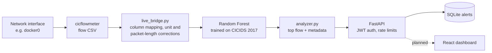

# NetGuard-NG

Network anomaly detection for a lab network. It captures traffic, turns it into
flow features, and scores each flow with a Random Forest trained on the CICIDS
2017 dataset. Results are served by an authenticated FastAPI backend and stored
as alerts.

> **Status:** backend complete and tested against nmap SYN scans in a Docker
> lab. A React dashboard is planned. Read [Limitations](#limitations) before
> relying on the numbers.
>
> **Authorized use only.** Capture traffic on, and scan, only networks and
> systems you own or have explicit permission to test.

## How it works



1. **Capture:** the API runs `cicflowmeter` on a chosen interface for a fixed
   window (default 60 s) and stops it cleanly so the CSV is flushed.
2. **Bridge:** live flows differ numerically from the Java CICFlowMeter that
   built CICIDS 2017. `live_bridge.py` maps column names and corrects two
   confirmed differences (timing units and packet-length convention).
3. **Score:** the Random Forest labels each flow benign or attack and gives an
   attack probability.
4. **Report:** the API returns the highest-confidence flow with its metadata
   and stores an alert when the result is an attack.

## Results (summary)

Tested against nmap SYN scans (`-sS -p 1-1000`) of a local DVWA Docker
container. Full method, tables and caveats: [EVALUATION.md](EVALUATION.md).

| Test | Result |
|---|---|
| Fresh scans, scan-direction flows flagged | 72-77% (three captures, 453-483 flows each) |
| Flows where the target replied | ~99% flagged |
| Flows with no reply from the target | 0 of 351 flagged (known blind spot) |
| Benign baseline (167 flows: HTTP, login, ping) | 0 false positives |

Every scan run was detected at the capture level (`POST /analyze` returned
`ATTACK`). Only SYN scans against one lab target have been validated.

## Tech stack

Python 3.13, FastAPI, SQLAlchemy (SQLite by default), scikit-learn, pandas,
Scapy and `cicflowmeter` for capture, JWT (python-jose) and bcrypt (passlib),
slowapi for rate limiting, pytest, and [uv](https://docs.astral.sh/uv/) for
dependency management.

## Getting started

Requires Linux (raw-socket capture), Python 3.13, `uv`, and Docker for the lab
target.

```bash
git clone https://github.com/Rhishamah/NetGuard-NG.git
cd NetGuard-NG
uv sync
```

**1. Configure.** Create a `.env` file in the project root (it is gitignored):

```bash
# generate a secret key
uv run python -c "import secrets; print(secrets.token_urlsafe(32))"
# generate a bcrypt hash for the admin password
uv run python -c "import getpass; from passlib.context import CryptContext; print(CryptContext(schemes=['bcrypt']).hash(getpass.getpass('Password: ')))"
```

```
SECRET_KEY=<generated key>
ADMIN_USERNAME=admin
ADMIN_PASSWORD_HASH='<bcrypt hash>'
```

**2. Get the data and train.** Download the CICIDS 2017 Friday file as
`data/cicids2017/friday.csv` (not included in the repo), then:

```bash
uv run python -m model.detector      # writes model/trained/*.pkl
```

**3. Allow capture without running as root.** This grants raw-socket rights to
the project's Python interpreter only:

```bash
sudo setcap cap_net_raw,cap_net_admin+eip $(readlink -f .venv/bin/python)
```

**4. Run the API** (as your normal user, not with `sudo`):

```bash
uv run uvicorn api.main:app
```

Interactive docs: `http://127.0.0.1:8000/docs`. The lab setup, attack
simulations and troubleshooting are in [TESTING.md](TESTING.md), and
`scripts/scan_test.py` automates capture, traffic generation and scoring.

## API

All routes except `/`, `/status` and `/token` need a bearer token.

| Method and path | Purpose |
|---|---|
| `POST /token` | Log in as the admin and get a JWT (5 attempts/min) |
| `GET /status` | Health: database connection and whether the model is loaded |
| `POST /analyze/` | Capture for 60 s on `interface`, score it, return the result (5/min) |
| `POST /capture/start`, `POST /capture/stop`, `GET /capture/status` | Start, stop and inspect a background capture |
| `GET /alerts/`, `GET /alerts/{id}`, `DELETE /alerts/{id}` | List, read and delete stored alerts |

Example `/analyze/` response:

```json
{
  "prediction": "ATTACK",
  "confidence": 0.83,
  "severity": "anomaly",
  "source_ip": "172.17.0.1",
  "destination_ip": "172.17.0.2",
  "protocol": "6",
  "flows_analyzed": 512
}
```

Severity is `normal` (< 0.3), `suspicious` (< 0.7) or `anomaly` (>= 0.7).

## Security design

- Single admin account: bcrypt-hashed password and HS256 JWTs with an expiry,
  all secrets read from the environment.
- Rate limits on `/token`, `/analyze` and `/capture/start`.
- Capture runs through `setcap` on one interpreter instead of `sudo`, so the
  API never runs as root and never creates root-owned files.
- `interface` is checked against the host's real interfaces before it reaches a
  subprocess, and the subprocess is started without a shell.
- Capture file paths are chosen by the server and confined to
  `data/captures/`; clients cannot supply a path.
- Alerts are stored only for attack results.

Not yet done: CORS configuration (needed for the dashboard), multiple users or
roles, and HTTPS (run behind a TLS-terminating proxy for anything beyond a lab).

## Testing

```bash
uv run pytest -q
```

Unit and API tests cover the bridge's unit conversion, path and interface
validation, alert storage rules and the login rate limit.

## Limitations

- **Scans with no reply are missed.** Only 2 of 159,066 Portscan flows in the
  training file have zero backward packets, and no such flow was flagged in
  testing (0 of 351). A scan against silently dropping ports would be missed at
  the flow level.
- **Narrow validation.** Only SYN scans against one target were tested.
  TCP-connect, UDP and flood traffic, and high-volume benign traffic, are
  untested.
- **Calibrated, not derived.** The packet-length correction constant was tuned
  empirically on one early capture.
- **Windowed, not streaming.** Detection runs on fixed capture windows, not
  continuously.
- **Single training day.** The model was trained on the Friday CICIDS 2017 file
  only.

## Roadmap

- [ ] React dashboard (login, run analysis, alert table, charts)
- [ ] CORS limited to the dashboard origin
- [ ] Per-source aggregate detection (distinct destination ports per window)
- [ ] Continuous monitoring with rolling windows and live alerts
- [ ] Evaluate TCP-connect, UDP and flood traffic and larger benign captures
- [ ] Evaluate on other CICIDS 2017 days
- [ ] CI (tests on every push) and a container image

## Project layout

```
api/          FastAPI app: routers, services (capture, analyzer, model registry), models, schemas
model/        training (detector.py), inference (predict.py), live-capture bridge (live_bridge.py)
scripts/      scan_test.py (automated test run), score_capture.py (score a capture CSV)
capture/      early Scapy prototype of packet capture and 10-second window features
notebooks/    feature exploration, model training, live integration experiments
tests/        pytest suite
```

## Documentation

- [EVALUATION.md](EVALUATION.md): test method, results and caveats
- [MODEL_DOCUMENTATION.md](MODEL_DOCUMENTATION.md): dataset, features, models
- [TESTING.md](TESTING.md): lab setup and runbook
- [notes.md](notes.md): debugging notes and decisions
